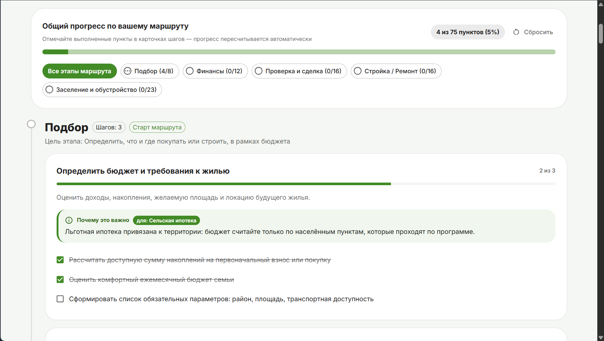
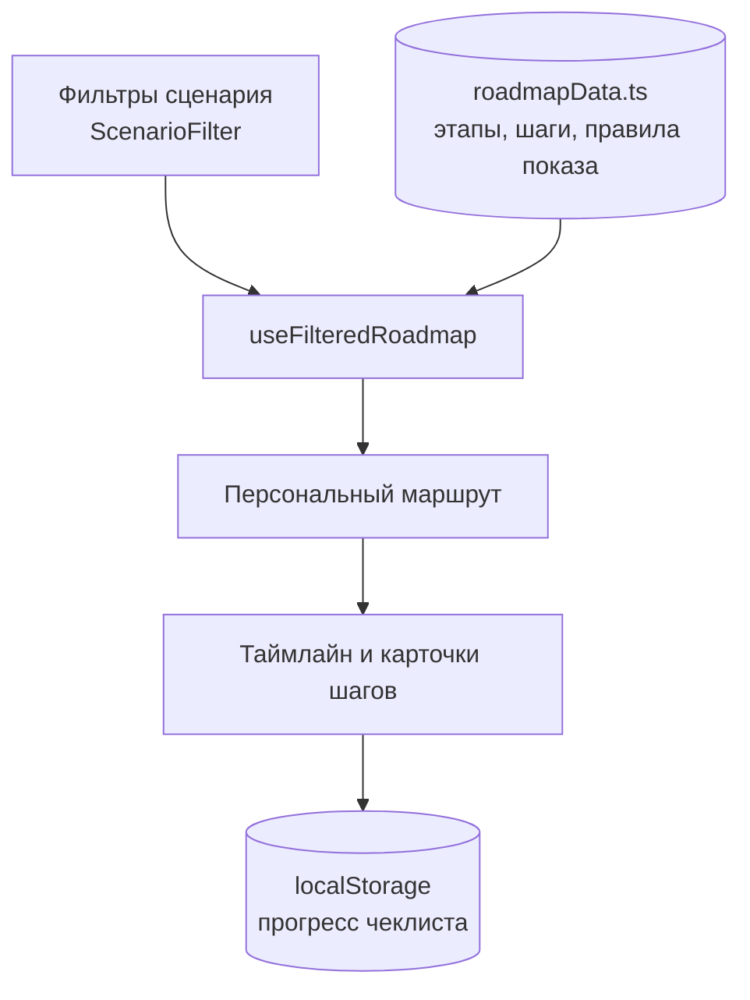
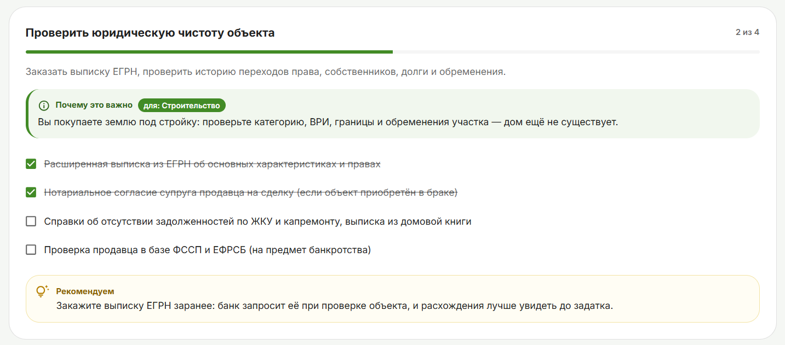
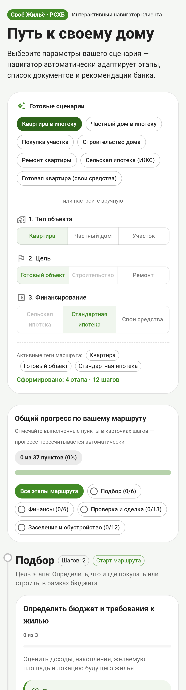
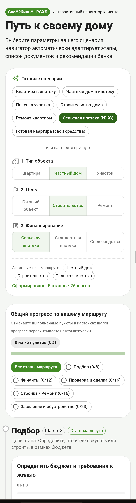

# RSHB Home Guide — навигатор пути клиента «Своё Жильё»

Интерактивный навигатор, который по выбранным параметрам сценария (тип объекта, цель, способ финансирования) собирает **персональный маршрут клиента**: от подбора жилья до заселения и налоговых вычетов. Для каждого шага показываются чеклист документов, рекомендация банка и пояснение, **почему этот шаг важен именно в выбранном сценарии**.

> **Демо:** [GitHub Pages](https://iichn.github.io/rshb-home-guide/) · [Vercel, зеркало](https://rshb-home-guide-alpha.vercel.app) (VPN)


---

## Содержание

1. [Задача](#задача)
2. [Что умеет приложение](#что-умеет-приложение)
3. [Быстрый старт](#быстрый-старт)
4. [Сценарии и матрица ветвления](#сценарии-и-матрица-ветвления)
5. [Как работает «Почему это важно»](#как-работает-почему-это-важно)
6. [Use Cases](#use-cases)
7. [Архитектура](#архитектура)
8. [Модель данных](#модель-данных)
9. [Структура проекта](#структура-проекта)
10. [Технологии](#технологии)
11. [Деплой](#деплой)
12. [Ограничения](#ограничения)
13. [План работ](#план-работ)
14. [Скриншоты](#скриншоты)
---

## Задача

Задача реализована в рамках проекта "Стипендиальная программа 2026–2027" от РСХБ.
Выбрана задача №2 в рамках проекта "Своё Жильё"

> **Задача 2: Интерактивный навигатор «Путь к своему дому»**
>
> Разработайте пошаговый навигатор от выбора недвижимости до сделки и обустройства. Он должен адаптироваться под квартиру, частный дом, участок, строительство, ремонт, сельскую ипотеку и готовый объект.
>
> **Порядок действий**
> 1. Опишите этапы пути клиента от выбора недвижимости до оформления сделки и обустройства.
> 2. Сделайте сценарии для квартиры, дома, участка, строительства, ремонта, сельской ипотеки и готового объекта.
> 3. Покажите, как навигатор меняет шаги в зависимости от выбранного сценария.
>
> **Что нужно представить:** Покажите, как шаги и рекомендации меняются для каждого сценария пользователя.
>
> #### Сделать навигатор, который помогает клиенту пройти путь «от идеи до заселения» и **перестраивается в зависимости от выбранных фильтров**.
>
> **Ключевые требования:**
>
> - маршрут состоит из этапов и шагов, набор которых зависит от фильтров;
> - у каждого шага есть пояснение «почему это важно в вашем сценарии»;
> - для шагов есть чеклисты документов и рекомендации банка;
> - готовое решение доступно по ссылке без клонирования репозитория.

## Что умеет приложение

- **Конфигуратор сценария** — тип объекта, цель, финансирование. Недопустимые комбинации заблокированы с подсказкой (например, ремонт участка или ипотека на ремонт).
- **Готовые сценарии** — 7 пресетов в 1 клик, например «Сельская ипотека (ИЖС)».
- **Таймлайн** — этапы со статусами и общим прогресс-баром; нумерация этапов считается по построенному маршруту.
- **Карточки шагов** — чеклист документов, блок «Рекомендуем» и плашка «Почему это важно» с пометкой «Специфика», если текст подобран под ваш сценарий.
- **Прогресс сохраняется** в `localStorage`: отметки не пропадают после перезагрузки.
- **Реактивная перестройка**: при смене фильтра маршрут и подсказки обновляются сразу.

## Быстрый старт

```bash
git clone https://github.com/iichn/rshb-home-guide.git
cd rshb-home-guide
npm install
npm run dev      # режим разработки
npm run build    # production-сборка
npm run preview  # локальный просмотр сборки
```

Требуется Node.js 20+.

## Сценарии и матрица ветвления

### Базовый путь клиента


| Этап | Суть |
|---|---|
| 1. Подбор | Определение объекта, бюджета и требований к нему |
| 2. Финансы / Ипотека | Выбор программы, расчёт платежа, сбор документов, одобрение |
| 3. Проверка и сделка | Юридическая проверка объекта и продавца, оформление сделки |
| 4. Стройка / Ремонт | Подрядчик, смета, этапы работ, контроль (только для соответствующих сценариев) |
| 5. Заселение и обустройство | Регистрация, коммуникации, налоговые вычеты, обустройство быта |

### Фильтры

| Параметр | Значения |
|---|---|
| Тип объекта | Квартира · Дом · Участок |
| Цель | Готовый объект · Строительство · Ремонт |
| Финансирование | Сельская ипотека · Стандартная ипотека · Собственные средства |

### Как меняется маршрут (7 базовых пресетов)

Сценарий задаётся тремя фильтрами (`Объект` × `Цель` × `Финансирование`), а 7 сценариев из условия задачи вынесены в быстрые пресеты:

| № | Пресет | Теги | Этапов · шагов | Ключевые изменения маршрута |
|---|---|---|---|---|
| 1 | **Квартира в ипотеку** | `apartment` + `ready` + `standard` | 4 · 12 | Базовый ипотечный путь без стройки и земельных проверок; доступны оба налоговых вычета (5.5a, 5.5b) |
| 2 | **Частный дом в ипотеку** | `house` + `ready` + `standard` | 4 · 14 | Добавляются проверка категории земли и ВРИ (3.2) и подключение коммуникаций (5.2) |
| 3 | **Покупка участка** | `plot` + `ready` + `standard` | 4 · 10 | Фокус на выборе и проверке участка (1.3, 3.2); вычеты (5.5a, 5.5b), ЖКУ (5.6) и обустройство (5.7) скрыты до постройки дома |
| 4 | **Строительство дома** | `plot` + `build` + `standard` | 5 · 20 | Смета и проект договора подряда для банка (2.4); полный Этап 4 (проект, ПЗЗ, подряд, поэтапная приёмка); ввод дома в эксплуатацию (5.1) |
| 5 | **Ремонт квартиры** | `apartment` + `repair` + `own` | 4 · 6 | Этап 3 (сделка) и налоговые вычеты скрыты; финансы — бюджет ремонта (2.6); Этап 4 — смета, перепланировка (4.6), приёмка работ |
| 6 | **Сельская ипотека (ИЖС)** | `house` + `build` + `rural` | 5 · 26 | Спецшаги программы: проверка населённого пункта (1.4), занятости (2.2), срок стройки 24 мес. (4.1b), подрядчик (4.3), прописка за 180 дней (5.3), занятость 5 лет (5.4) |
| 7 | **Готовая квартира (свои средства)** | `apartment` + `ready` + `own` | 4 · 9 | От пресета 1 отличается: исчезают расчёт платежа и заявка (2.1, 2.3), оценка и страхование залога (3.3), вычет по процентам (5.5b); появляется шаг «Источник средств и резерв» (2.5) |

Полная спецификация шагов, матрица ветвления и грамматика условий — в [`docs/scenarios.md`](docs/scenarios.md).

## Как работает «Почему это важно»

У каждого шага есть базовый текст `why` и необязательный `whyOverrides` — тексты под конкретные теги. Если для выбранных тегов есть override, показывается он, а в карточке появляется бейдж «Специфика: …». При нескольких совпадениях приоритет такой: финансирование → цель → объект.

Пример — шаг 3.1 «Проверить юридическую чистоту объекта»:

| Сценарий | Какой текст показан |
|---|---|
| Квартира + стандартная ипотека | про обременения и требования банка (`apartment`) |
| Дом + строительство | про землю под стройку, дома ещё нет (`build`) |
| Квартира + свои средства | про ответственность покупателя без юристов банка (`own`) |

## Основные сценарии использования

1. **Строю дом по сельской ипотеке** — клиент видит полный маршрут со стройкой и проверкой соответствия подрядчика требованиям банка.
2. **Покупаю готовую квартиру в ипотеку** — короткий маршрут без стройки, фокус на проверке сделки и вычетах.
3. **Покупаю участок за свои средства / в ипотеку** — фокус на проверке категории земли и ВРИ.
4. **Делаю ремонт** — маршрут с этапом ремонта, согласованием перепланировки и подбором бригады.

> Пресеты вынесены на стартовый экран как быстрые сценарии для ревью.

> Остальные комбинации — в таблице пресетов выше; любую можно собрать вручную в конфигураторе.

## Архитектура

Данные и логика отделены от интерфейса:



- Каждый шаг в `roadmapData.ts` содержит **правила показа** (теги/условия): шаг попадает в маршрут, только если фильтры им соответствуют.
- `useFilteredRoadmap(filters)` — чистая функция/хук: на вход параметры сценария, на выход — массив нужных этапов и шагов.
- UI только отображает результат и хранит состояние выполнения.

## Модель данных

Типы описаны в `src/types/navigator.ts`:

## Модель данных

Типы в `src/types/navigator.ts`:

- `ScenarioFilter` — выбранные параметры: `object`, `goal`, `finance`;
- `RoadmapStage` — этап: `id`, `title`, `goal`, `steps`;
- `RoadmapStep` — шаг: `title`, `description`, `checklist`, `recommendation?`, `why`, `whyOverrides?`, `condition?`;
- `Recommendation` — рекомендация банка: `text`, `link?`;
- `Cond` — условие показа: тег или `{ and: [...] }`, `{ or: [...] }`, `{ not: ... }`;
- `ResolvedRoadmapStage` / `ResolvedRoadmapStep` — результат фильтрации с готовым `resolvedWhy`.

Пример: шаг 4.3 показывается только при строительстве по сельской ипотеке:

```ts
condition: { and: ['build', 'rural'] }
```

## Структура проекта

```
rshb-home-guide/
├── .github/workflows/deploy.yml
├── docs/
│   ├── scenarios.md
│   └── img/
├── src/
│   ├── types/navigator.ts
│   ├── data/roadmapData.ts
│   ├── hooks/useFilteredRoadmap.ts
│   ├── components/
│   │   ├── ScenarioConfigurator.tsx
│   │   ├── RoadmapTimeline.tsx
│   │   └── StepCard.tsx
│   ├── App.tsx
│   └── main.tsx
└── README.md
```

## Технологии

- React + TypeScript (Vite)
- MUI или Tailwind CSS
- Деплой: GitHub Pages / Vercel

## План работ

| Дата | Фокус | Результат |
|---|---|---|
| 23 окт | Аналитика и матрица сценариев | Раздел аналитики с матрицей условий |
| 24 окт | Инициализация и модель данных | Скелет проекта и типизированный контракт без ошибок TS |
| 25 окт | База знаний и движок фильтрации | `roadmapData.ts` и `useFilteredRoadmap` на реальных шагах |
| 26 окт | Экран конфигуратора | Панель фильтров и пресеты |
| 27 окт | Визуализация таймлайна | Этапы, прогресс, карточки шагов, «почему это важно» |
| 28 окт | Интерактивность и UI | Чеклисты с сохранением, фирменный стиль |
| 29 окт | Деплой и сдача | Демо-ссылка, финальный README, отправка решения |

Статус: ✅ готово

## Скриншоты

### Конфигуратор


### Маршрут: сельская ипотека


### Карточка шага


### Разные маршруты — мобильный вид

| Квартира в ипотеку | Сельская ипотека |
|---|---|
|  |  |