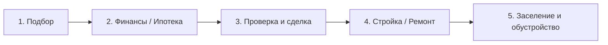
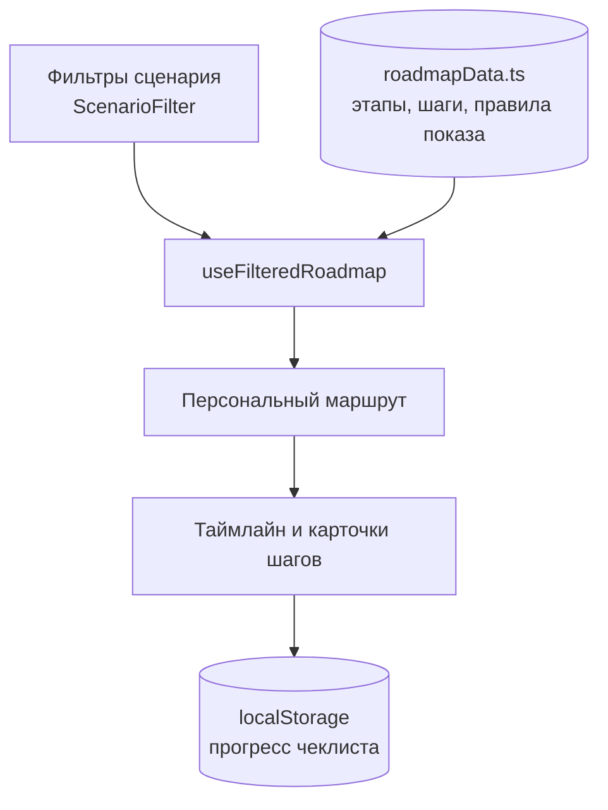
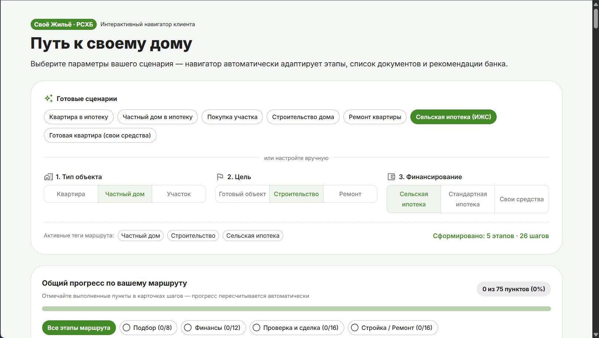

# RSHB Home Guide — навигатор пути клиента «Своё Жильё»

Интерактивный навигатор, который по выбранным параметрам сценария (тип объекта, цель, способ финансирования) собирает **персональный маршрут клиента**: от подбора жилья до заселения и налоговых вычетов. Для каждого шага показываются чеклист документов, рекомендация банка и пояснение, **почему этот шаг важен именно в выбранном сценарии**.

> 🔗 **Демо:** _ссылка появится после деплоя (~29 окт)
> 📸 **Скриншоты:** см. раздел [Скриншоты](#скриншоты) (позже)

---

## Содержание

1. [Задача](#задача)
2. [Что умеет приложение](#что-умеет-приложение)
3. [Быстрый старт](#быстрый-старт)
4. [Сценарии и матрица ветвления](#сценарии-и-матрица-ветвления)
5. [Use Cases](#use-cases)
6. [Архитектура](#архитектура)
7. [Модель данных](#модель-данных)
8. [Структура проекта](#структура-проекта)
9. [План работ](#план-работ)
10. [Скриншоты](#скриншоты)

---

## Задача

> **Задача 2: Интерактивный навигатор «Путь к своему дому»**
>
> Разработайте пошаговый навигатор от выбора недвижимости до сделки и обустройства. Он должен адаптироваться под квартиру, частный дом, участок, строительство, ремонт, сельскую ипотеку и готовый объект.
>
> **Порядок действий**
> 1. Опишите этапы пути клиента от выбора недвижимости до оформления сделки и обустройства.
> 2. Сделайте сценарии для квартиры, дома, участка, строительства, ремонта, сельской ипотеки и готового объекта.
> 3. Покажите, как навигатор меняет шаги в зависимости от выбранного сценария.
>
> **Что нужно представить:** Покажите, как шаги и рекомендации меняются для каждого сценария пользователя.
>
> #### Сделать навигатор, который помогает клиенту пройти путь «от идеи до заселения» и **перестраивается в зависимости от выбранных фильтров**.
>
> **Ключевые требования:**
>
> - маршрут состоит из этапов и шагов, набор которых зависит от фильтров;
> - у каждого шага есть пояснение «почему это важно в вашем сценарии»;
> - для шагов есть чеклисты документов и рекомендации банка;
> - готовое решение доступно по ссылке без клонирования репозитория.

## Что умеет приложение

- **Конфигуратор сценария** — тип объекта, цель, финансирование.
- **Быстрые сценарии в 1 клик** — пресеты, например «Строю дом по сельской ипотеке».
- **Таймлайн (roadmap)** — этапы со статусами и общим прогресс-баром.
- **Карточки шагов** — чеклист документов, блок «Рекомендация банка», плашка «Почему это важно в вашем сценарии».
- **Прогресс сохраняется** в `localStorage`: отметки в чеклисте не пропадают после перезагрузки.
- **Реактивная перестройка**: при смене фильтра маршрут и подсказки обновляются сразу.

## Быстрый старт

```bash
git clone [https://github.com/](https://github.com/)<username>/rshb-home-guide.git
cd rshb-home-guide
npm install
npm run dev      # режим разработки
npm run build    # production-сборка
npm run preview  # локальный просмотр сборки
```

Требуется Node.js 18+.

## Сценарии и матрица ветвления

### Базовый путь клиента



| Этап | Суть |
|---|---|
| 1. Подбор | Определение объекта, бюджета и требований к нему |
| 2. Финансы / Ипотека | Выбор программы, расчёт платежа, сбор документов, одобрение |
| 3. Проверка и сделка | Юридическая проверка объекта и продавца, оформление сделки |
| 4. Стройка / Ремонт | Подрядчик, смета, этапы работ, контроль (только для соответствующих сценариев) |
| 5. Заселение и обустройство | Регистрация, коммуникации, налоговые вычеты, обустройство быта |

### Фильтры

| Параметр | Значения |
|---|---|
| Тип объекта | Квартира · Дом · Участок |
| Цель | Готовый объект · Строительство · Ремонт |
| Финансирование | Сельская ипотека · Стандартная ипотека · Собственные средства |

### Как меняется маршрут (7 базовых пресетов)

Сценарий задаётся тремя фильтрами (`Объект` × `Цель` × `Финансирование`), а 7 сценариев из условия задачи вынесены в быстрые пресеты:

| № | Пресет сценария | Комбинация тегов | Ключевые изменения маршрута |
|---|---|---|---|
| 1 | **Квартира** | `apartment` + `ready` + `standard` | Базовый ипотечный путь без стройки и земельных проверок; доступны оба налоговых вычета (5.5a, 5.5b) |
| 2 | **Частный дом** | `house` + `ready` + `standard` | Добавляется проверка категории земли и ВРИ (3.2), а также подключение инженерных коммуникаций (5.2) |
| 3 | **Участок** | `plot` + `ready` + `standard` | Фокус на выборе и проверке участка (1.3, 3.2); имущественный вычет (5.5a) недоступен до постройки жилого дома |
| 4 | **Строительство** | `plot` + `build` + `standard` | Включается полный Этап 4 (проект, ПЗЗ, смета для банка, договор подряда, поэтапная приёмка) и ввод дома в эксплуатацию (5.1) |
| 5 | **Ремонт** | `apartment` + `repair` + `own` | Пропускается Этап 3 (сделка) и налоговые вычеты; Этап 4 переключается на смету ремонта, перепланировку (4.6) и приёмку работ |
| 6 | **Сельская ипотека** | `house` + `build` + `rural` | Добавляются спецшаги программы: проверка численности НП до 30 тыс. чел. (1.4), занятости (2.2), лимит стройки 24 мес. (4.1b), проверка подрядчика (4.3), прописка за 180 дней (5.3) и подтверждение работы 5 лет (5.4) |
| 7 | **Готовый объект** | `apartment` + `ready` + `own` | Отличается от Пресета 1 способом финансирования: исчезают заявка на кредит, оценка/страхование залога (3.3) и вычет по процентам (5.5b) |

Полная спецификация шагов, матрица ветвления и грамматика условий — в [`docs/scenarios.md`](docs/scenarios.md).

## Use Cases

1. **Строю дом по сельской ипотеке** — клиент видит полный маршрут со стройкой и проверкой соответствия подрядчика требованиям банка.
2. **Покупаю готовую квартиру в ипотеку** — короткий маршрут без стройки, фокус на проверке сделки и вычетах.
3. **Покупаю участок за свои средства / в ипотеку** — фокус на проверке категории земли и ВРИ.
4. **Делаю ремонт** — маршрут с этапом ремонта, согласованием перепланировки и подбором бригады.

> Пресеты вынесены на стартовый экран как быстрые сценарии для ревью.

## Архитектура

Данные и логика отделены от интерфейса:



- Каждый шаг в `roadmapData.ts` содержит **правила показа** (теги/условия): шаг попадает в маршрут, только если фильтры им соответствуют.
- `useFilteredRoadmap(filters)` — чистая функция/хук: на вход параметры сценария, на выход — массив нужных этапов и шагов.
- UI только отображает результат и хранит состояние выполнения.

## Модель данных

Типы описаны в `src/types/navigator.ts`:

- `ScenarioFilter` — выбранные параметры сценария;
- `RoadmapStage` — этап маршрута;
- `ChecklistItem` — пункт чеклиста документов/действий;
- `Recommendation` — рекомендация банка.

## Структура проекта

```
rshb-home-guide/
├── docs/
│   └── scenarios.md        # аналитика и матрица сценариев
├── src/
│   ├── types/navigator.ts  # типизированный контракт данных
│   ├── data/roadmapData.ts # этапы, шаги, правила показа
│   ├── hooks/              # useFilteredRoadmap
│   └── components/         # конфигуратор, таймлайн, карточки шагов
└── README.md
```

## Технологии

- React + TypeScript (Vite)
- MUI или Tailwind CSS
- Деплой: GitHub Pages / Vercel
- Фирменный стиль РСХБ / «Своё Жильё»: основной зелёный `#428B26`, тёмно-зелёный, светлый фон

## План работ

| Дата | Фокус | Результат |
|---|---|---|
| 23 окт | Аналитика и матрица сценариев | Раздел аналитики с матрицей условий |
| 24 окт | Инициализация и модель данных | Скелет проекта и типизированный контракт без ошибок TS |
| 25 окт | База знаний и движок фильтрации | `roadmapData.ts` и `useFilteredRoadmap` на реальных шагах |
| 26 окт | Экран конфигуратора | Панель фильтров и пресеты |
| 27 окт | Визуализация таймлайна | Этапы, прогресс, карточки шагов, «почему это важно» |
| 28 окт | Интерактивность и UI | Чеклисты с сохранением, фирменный стиль |
| 29 окт | Деплой и сдача | Демо-ссылка, финальный README, отправка решения |

Статус: 🟡 в разработке

## Скриншоты

_Будут добавлены после ~28 окт._

<!--  -->
<!--  -->