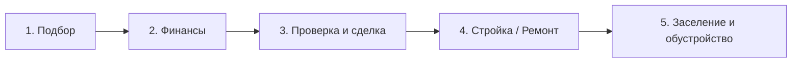

# Сценарии навигатора «Путь к своему дому»

Документ описывает этапы пути клиента и то, как набор шагов и рекомендаций меняется в зависимости от сценария. Он служит спецификацией для `src/data/roadmapData.ts` и `useFilteredRoadmap`.

---

## 1. Модель сценария

Семь сценариев из задания не независимы: «готовый объект» пересекается с «квартирой» и «домом», «сельская ипотека» — это способ финансирования. Поэтому сценарий задаётся **тремя параметрами**, а семь сценариев из задания реализуются как **пресеты** поверх них.

| Параметр | Значения | Теги |
|---|---|---|
| Объект | Квартира · Дом · Участок | `apartment` · `house` · `plot` |
| Цель | Готовый объект · Строительство · Ремонт | `ready` · `build` · `repair` |
| Финансирование | Сельская ипотека · Стандартная ипотека · Свои средства | `rural` · `standard` · `own` |

### Допустимые комбинации

| Правило | Пояснение |
|---|---|
| `plot` → цель `ready` (покупка участка) или `build` | Ремонт участка не имеет смысла |
| `repair` → объект `apartment` или `house` | Ремонт относится к уже существующему жилью |
| `rural` → объект `house`, цель `ready` или `build` | Сельская ипотека ориентирована на дом на сельской территории (Населенные пункты с численностью населения до 30 тысяч человек): покупка квартиры возможна только в малоэтажном доме (до 5 этажей). |
| `repair` + `rural` | Недопустимо: программа не предназначена для ремонта. Только для достройки |

UI должен отключать недопустимые значения, а не показывать ошибку после выбора.

### Пресеты (7 сценариев из задания)

| № | Сценарий | Объект | Цель | Финансирование |
|---|---|---|---|---|
| 1 | Квартира | `apartment` | `ready` | `standard` |
| 2 | Частный дом | `house` | `ready` | `standard` |
| 3 | Участок | `plot` | `ready` | `standard` |
| 4 | Строительство | `plot` | `build` | `standard` |
| 5 | Ремонт | `apartment` | `repair` | `own` |
| 6 | Сельская ипотека | `house` | `build` | `rural` |
| 7 | Готовый объект | `house` | `ready` | `own` |

Пресеты 1 и 7 различаются финансированием, чтобы наглядно показать разницу в шагах.

---

## 2. Этапы пути клиента

| Этап | Цель клиента | Когда этап пропускается |
|---|---|---|
| 1. Подбор | Определить, что и где покупать или строить, в рамках бюджета | Никогда |
| 2. Финансы | Выбрать источник денег и получить одобрение | Не пропускается; для `own` сокращается до расчёта бюджета |
| 3. Проверка и сделка | Убедиться в юридической чистоте и оформить сделку | При `repair` (объект уже в собственности) |
| 4. Стройка / Ремонт | Построить или отремонтировать | При `ready` |
| 5. Заселение и обустройство | Зарегистрироваться, подключить коммуникации, получить вычеты | Никогда |

---

## 3. Шаги и правила показа

Условие записывается как набор тегов. Пустое условие означает «показывать всегда».

### Этап 1. Подбор

| id | Шаг | Условие показа |
|---|---|---|
| 1.1 | Определить бюджет и требования к жилью | всегда |
| 1.2 | Выбрать готовый объект: сравнить варианты, осмотреть | `ready` и (`apartment` или `house`) |
| 1.3 | Выбрать участок: расположение, назначение, коммуникации | `plot` или `build` |
| 1.4 | Проверить, что населённый пункт с населением не более 30 тыс. человек | `rural` |

### Этап 2. Финансы

| id | Шаг | Условие показа |
|---|---|---|
| 2.1 | Рассчитать платёж и первоначальный взнос | `standard` или `rural` |
| 2.2 | Проверить право на сельскую ипотеку: сфера занятости заёмщика, трудовой договор. (допускается работа в АПК, работа в селе, бизнес на селе, участники СВО) | `rural` |
| 2.3 | Собрать документы заёмщика и подать заявку | `standard` или `rural` |
| 2.4 | Для строительства: подготовить смету и договор подряда для банка | (`standard` или `rural`) и `build` |
| 2.5 | Зафиксировать источник средств и резерв на непредвиденные расходы | `own` |
| 2.6 | Определить, чем оплачивается ремонт: накопления или целевой кредит | `repair` |

### Этап 3. Проверка и сделка

| id | Шаг | Условие показа |
|---|---|---|
| 3.1 | Проверить юридическую чистоту объекта: выписка ЕГРН, история, собственники, обременения | не `repair` |
| 3.2 | Проверить категорию земли и вид разрешённого использования | `plot` или `build` или `house` |
| 3.3 | Оценка объекта и страхование | `standard` или `rural` |
| 3.4 | Подписать договор и зарегистрировать право собственности | не `repair` |
| 3.5 | Безопасный расчёт с продавцом | не `repair` |

### Этап 4. Стройка / Ремонт

| id | Шаг | Условие показа |
|---|---|---|
| 4.1 | Выбрать проект, получить разрешение или направить уведомление о строительстве (аккредитованный подрядчик, домокомплекты в материалах, срок в 24 месяца, коммуникации для круглогодичного проживания, увеомление администрации о строительстве, учесть зонирование земли, охранные зоны) | `build` |
| 4.2 | Заключить договор строительного подряда | `build` |
| 4.3 | Проверка подрядчика на аккредитацию в РСХБ (не обязательно в рсхб) | `build` и `rural` |
| 4.4 | Поэтапное финансирование и приёмка работ | `build` |
| 4.5 | Составить смету ремонта и выбрать подрядчика | `repair` |
| 4.6 | Согласовать перепланировку, если она нужна (обязательно + если прошлый владелец ее не согласовал, в кредите откажут) | `repair` и `apartment` |
| 4.7 | Приёмка ремонта и закрытие актов | `repair` |

### Этап 5. Заселение и обустройство

| id | Шаг | Условие показа |
|---|---|---|
| 5.1 | Ввод построенного дома в эксплуатацию, постановка на кадастровый учёт (полный ввод в эксплуатацию в течении 24 месяцев) | `build` |
| 5.2 | Подключить коммуникации | `house` или `plot` или `build` |
| 5.3 | Зарегистрироваться по месту жительства (по условиям сельской ипотеки — в установленный срок) (На это дается ровно 180 дней (6 месяцев) с момента регистрации права собственности на готовый дом) | `rural` |
| 5.4 | Подтверждать место работы по требованию банка в течение срока кредита (При подписании договора вы берете на себя обязательство отработать в сельской сфере (АПК, медицина, образование, культура на селе) не менее 5 лет) | `rural` |
| 5.5 | Оформить налоговые вычеты (два типа: Имущественный вычет (за покупку дома/земли): 13% от стоимости объекта, но максимум с лимита в 2 млн рублей. То есть вернуть можно до 260 000 рублей. Процентный вычет (за уплаченные банку проценты): 13% от фактически выплаченных банку процентов, но максимум с лимита в 3 млн рублей. Максимальный возврат — до 390 000 рублей.) | не `plot`-only покупка без строительства |
| 5.6 | Обустроить жильё: мебель, техника, страхование имущества | не `repair` |

---

## 4. Матрица: что видит клиент в каждом пресете

✓ — шаг есть, — — шага нет.

| Шаг | 1 Квартира | 2 Дом | 3 Участок | 4 Строит. | 5 Ремонт | 6 Сельск. ипотека | 7 Готовый |
|---|---|---|---|---|---|---|---|
| 1.1 Бюджет | ✓ | ✓ | ✓ | ✓ | ✓ | ✓ | ✓ |
| 1.2 Выбор готового объекта | ✓ | ✓ | — | — | — | — | ✓ |
| 1.3 Выбор участка | — | — | ✓ | ✓ | — | ✓ | — |
| 1.4 Проверка сельской территории | — | — | — | — | — | ✓ | — |
| 2.1–2.3 Расчёт, документы, заявка | ✓ | ✓ | ✓ | ✓ | — | ✓ | — |
| 2.2 Право на сельскую ипотеку | — | — | — | — | — | ✓ | — |
| 2.4 Смета и договор для банка | — | — | — | ✓ | — | ✓ | — |
| 2.5 Источник средств | — | — | — | — | — | — | ✓ |
| 2.6 Финансирование ремонта | — | — | — | — | ✓ | — | — |
| 3.1 Юр. чистота | ✓ | ✓ | ✓ | ✓ | — | ✓ | ✓ |
| 3.2 Категория земли | — | ✓ | ✓ | ✓ | — | ✓ | ✓ |
| 3.3 Оценка и страхование | ✓ | ✓ | ✓ | ✓ | — | ✓ | — |
| 3.4–3.5 Сделка и расчёт | ✓ | ✓ | ✓ | ✓ | — | ✓ | ✓ |
| 4.1–4.2, 4.4 Проект, подряд, приёмка | — | — | — | ✓ | — | ✓ | — |
| 4.3 Аккредитация подрядчика | — | — | — | — | — | ✓ | — |
| 4.5, 4.7 Смета и приёмка ремонта | — | — | — | — | ✓ | — | — |
| 4.6 Перепланировка | — | — | — | — | ✓ | — | — |
| 5.1 Ввод в эксплуатацию | — | — | — | ✓ | — | ✓ | — |
| 5.2 Коммуникации | — | ✓ | ✓ | ✓ | — | ✓ | ✓ |
| 5.3–5.4 Регистрация, подтверждение работы | — | — | — | — | — | ✓ | — |
| 5.5 Налоговые вычеты | ✓ | ✓ | — | ✓ | ✓ | ✓ | ✓ |
| 5.6 Обустройство | ✓ | ✓ | ✓ | ✓ | — | ✓ | ✓ |

---

## 5. «Почему этот шаг важен в вашем сценарии»

Для каждого шага в данных хранится не один текст, а набор вариантов по тегам. Примеры:

| Шаг | Условие | Текст пояснения |
|---|---|---|
| 3.1 Юр. чистота | `apartment` | Банк не выдаст ипотеку на объект с обременениями или спорной историей |
| 3.1 Юр. чистота | `house` | Дом и земля оформляются отдельно: нужно проверить права на оба объекта |
| 3.1 Юр. чистота | `own` | Без банка проверку объекта никто не сделает за вас — ошибка обойдётся дороже |
| 4.3 Аккредитация | `build` + `rural` | Банк может работать только с проверенными подрядчиками — без этого одобрение стройки под вопросом (подтверждено выше) |
| 5.3 Регистрация | `rural` | Условия программы привязаны к постоянному проживанию в доме (банк в праве проверять проживание, и аннулировать субсидию если дом не используется эффективно (коммуналка равна 0)) |

---

## 6. Рекомендации банка

Блок «Рекомендация банка» привязан к шагу и тоже может зависеть от тегов. Минимальный набор на MVP:

- 2.2 — предупреждение о требованиях к занятости заёмщика (сельская ипотека);
- 2.3 — подсказка про срок действия одобрения;
- 3.3 — рекомендация по страхованию;
- 4.3 — ссылка на проверку аккредитации подрядчика;
- 5.5 — напоминание о вычетах.

Тексты в MVP — **моковые**, но формулировки ограничений по сельской ипотеке сверяются с официальными источниками.

---

## 7. Источники для сверки

- Официальный сайт РСХБ (страницы про сельскую ипотеку и ипотеку на строительство)
- Сервис ДОМ.РФ «Сельская ипотека: условия и требования»
- Правила и перечень сельских территорий — на сайте банка
.